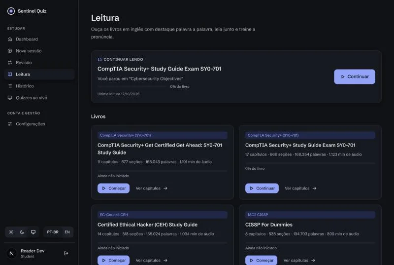
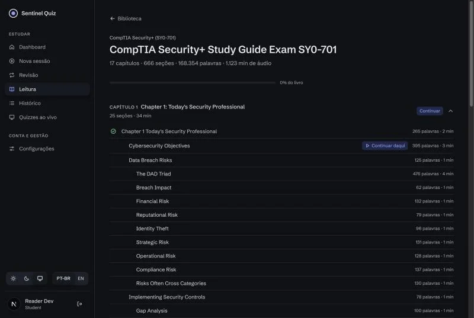
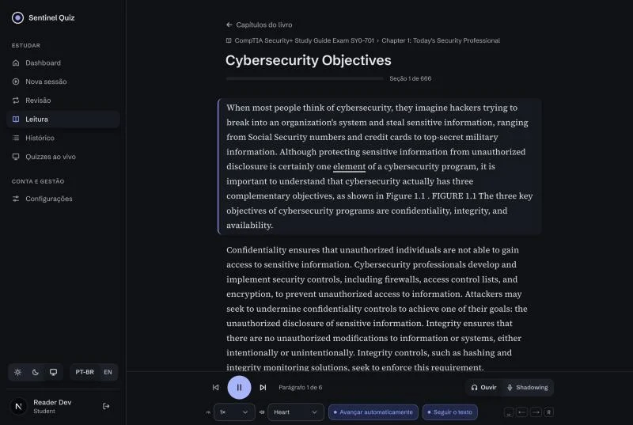
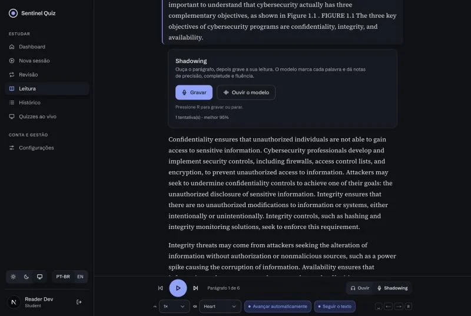
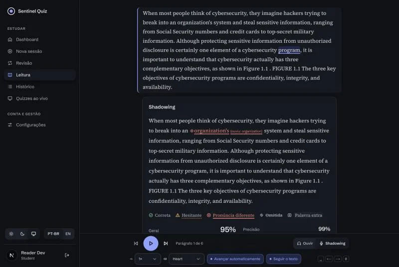
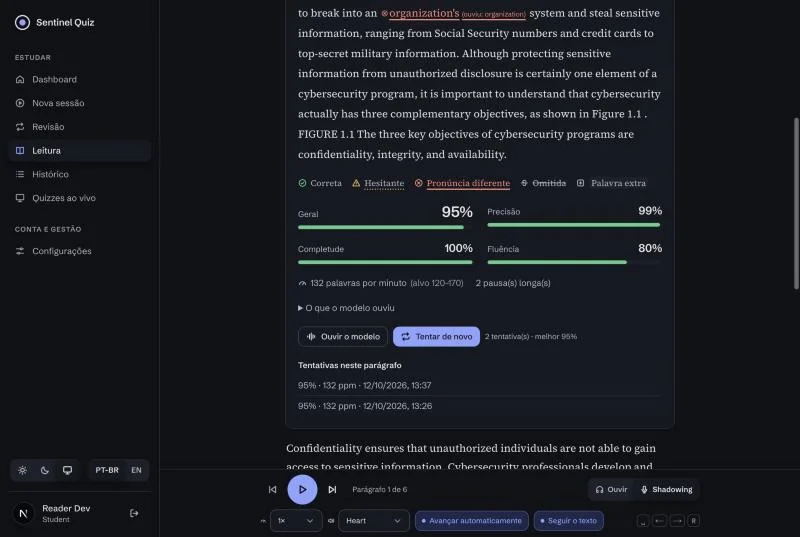
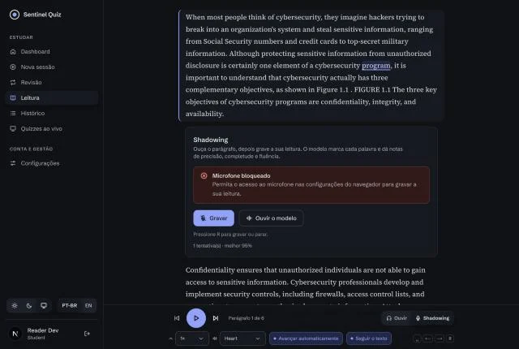

# Sentinel Reader: Incremento 1 (ouvir, ler junto e shadowing)

Primeiro incremento do [plano](./PLANO.md), sobre o [contrato](./CONTRATO-INCREMENTO-1.md).
- **Ouvir + ler junto:** voz neural local (Kokoro-82M) por parágrafo, palavra destacada em sincronia, clique para pular, velocidade e voz, avanço automático; fallback para a voz do navegador.
- **Shadowing com correção:** grave a leitura de um parágrafo e receba cada palavra marcada (ok, fraca, pronunciada errado com o que foi ouvido e o IPA, omitida, extra), notas de precisão, completude, fluência e geral, WPM e pausas.
- **Biblioteca e progresso:** os livros do corpus por capítulo e seção, "continuar de onde parei", histórico de tentativas e estatísticas.

## Telas

| | |
|---|---|
|  |  |
|  |  |
|  |  |
|  | |

## O que foi entregue

### Serviço de voz (`speech/`, novo)
| Área | Arquivos | Destaques |
|---|---|---|
| API interna | `speech/speech/{main,api,service,config,errors}.py` | `GET /healthz` (`ok`/`warming`), `POST /v1/tts`, `GET /v1/audio/{id}`, `POST /v1/assess`. Inferência no thread pool com um semáforo por engine (`SPEECH_MAX_CONCURRENCY`); espera até 60 s e responde `503 busy` com `Retry-After`. Token compartilhado opcional (`SPEECH_API_TOKEN`) |
| TTS | `engines/kokoro_tts.py`, `cache.py`, `audio.py` | Kokoro-82M (Apache 2.0) com **timestamps por token** (misaki); tokens mapeados para offsets do texto original (`text[char_start:char_end] == word`, verificado em 100 % das palavras no smoke test); mp3 64 kb/s via ffmpeg (ou wav); cache em disco por sha256 do pedido, LRU por tamanho |
| ASR + avaliação | `engines/faster_whisper_asr.py`, `engines/mlx_whisper_asr.py`, `textnorm.py`, `alignment.py`, `scoring.py`, `g2p.py` | faster-whisper `small.en` int8 com palavras e confiança, **sem** `initial_prompt`; normalização (números por extenso, `%`, hífens); Levenshtein com similaridade (rapidfuzz) → `ok`/`weak`/`mispronounced`/`missed` + `extras`; notas do contrato §4.7; IPA esperado × ouvido e dicas de sons (misaki) |
| Engines de teste | `engines/fake.py` | TTS silencioso com tempos uniformes e ASR dirigido por um payload `FAKE:<transcrição>`: o stack e os testes rodam sem modelos |
| Empacotamento | `pyproject.toml`, `uv.lock`, `Dockerfile`, `.dockerignore`, `README.md` | `uv sync && uv run speech-server`; imagem `python:3.12-slim` (digest fixo) com torch CPU, `ffmpeg`, `espeak-ng`, usuário não-root, **sem pesos** (baixados no primeiro start para `HF_HOME`) |
| Testes | `speech/tests/` (37) | offsets, alinhamento (perfeito, omissão, troca parecida, inserção, baixa confiança, números, hífens), fórmulas, API com engines fake (cache, áudio, 413/400/401/503, LRU) |

**Medições no MacBook Pro M1 Pro (CPU, 4 threads):** cold start com download ~46 s; TTS **0,135 s por segundo de áudio** (parágrafo de 90 palavras ≈ 4–5 s; cache 9 ms); avaliação **0,12 s por segundo de gravação** (clipe de 30 s ≈ 3,6 s); RSS 2,3 GB em regime, pico 2,9 GB (limite do container: 4 GB). O áudio sintetizado avaliado contra o próprio texto dá `overall` 0,95; um texto com uma palavra a mais e uma trocada devolve exatamente uma `missed` e uma `mispronounced` com `heard` e IPA.

### Backend
| Área | Arquivos | Destaques |
|---|---|---|
| Dados | `alembic/versions/0026_reading.py`, `models.py` | `reading_progress` (1 por usuário × livro, posição + totais) e `reading_attempt` (notas + `result_json`, nunca o áudio). Cascata com o usuário |
| Biblioteca e blocos | `services/reading.py` | Ordem de leitura = seções `teach`/`summary` com ≥ 20 palavras na ordem do documento; capítulos pelo stem do arquivo (`c04`); minutos a 150 wpm; `resolve_block` só aceita `part_id` da própria seção ou descendente (o texto nunca vem do cliente) |
| Serviço de voz | `services/speech_client.py` | Cliente httpx com health em cache (30 s) e falhas mapeadas para `503 speech_unavailable` / `speech_warming` / `504 speech_timeout`; `FakeSpeechClient` (`SPEECH_PROVIDER=fake`, recusado em produção) |
| API | `api/reading.py`, `schemas_reading.py` | `/api/reading`: `capabilities`, `library`, `books/{slug}/chapters/{file}`, `sections/{id}`, `sections/{id}/tts`, `audio/{id}`, `sections/{id}/assess` (multipart, allowlist de tipos, teto de bytes, quota diária), `progress`, `sections/{id}/attempts`, `stats`. Login obrigatório |
| Operação | `core/config.py`, `middleware/rate_limit.py`, `requirements.txt` | `READING_ENABLED`, `SPEECH_SERVICE_URL`, `SPEECH_API_TOKEN`, `SPEECH_TIMEOUT_SECONDS`, `SPEECH_MAX_AUDIO_BYTES`, `SPEECH_PROVIDER`, `READING_DAILY_ASSESS_QUOTA`; bucket `reading` (POST/PUT, 60/min por IP); `python-multipart` no lock |
| Testes | `tests/test_reading_api.py` (11) | login, capacidades com e sem serviço, feature desligada, biblioteca e ordem de leitura, progresso e conclusão por capítulo, TTS (texto do servidor, cache, autorização do `part_id`, voz inválida, áudio), avaliação com transcrição `FAKE:` (status, persistência, stats, quota, 413/415/404), bucket de rate limit, mapeamento de falhas HTTP |

### Frontend (`web/`)
| Área | Arquivos | Destaques |
|---|---|---|
| Rotas | `app/read/page.tsx`, `app/read/[book]/page.tsx`, `app/read/s/[sectionId]/page.tsx` | Biblioteca, capítulos/seções e leitor; `/read` protegido no `proxy.ts`; metadados `noindex` |
| Biblioteca | `features/reading/components/{library,book-chapters,reading-stats}.tsx` | Cartão "continuar de onde parei", livros com palavras/minutos e barra de progresso, estatísticas (tentativas, média, palavras lidas, minutos ouvidos, dias ativos); aviso quando a voz neural ou o shadowing estão indisponíveis; capítulos em acordeão com seções indentadas por nível e marca de concluído; o capítulo do progresso já abre aberto |
| Leitor | `components/{reader,read-along-block,player-bar}.tsx`, `lib/{use-audio-player,tokenize,blocks,prefs,keyboard}.ts` | Blocos com palavras em ``; **palavra atual destacada** por offset (`char_start/char_end`) com sublinhado; clique na palavra → seek; barra fixa com play/pause, parágrafo anterior/próximo, velocidade (0,75–1,25×), voz (7), avançar automaticamente e seguir o texto; pré-busca do próximo bloco; fim da seção → próxima; atalhos espaço/←/→/R; preferências em `localStorage` |
| Fallback | `lib/web-speech.ts` | `speechSynthesis` com voz inglesa e destaque por `onboundary` quando o serviço está fora ou aquecendo (aviso na tela; sem seek por palavra) |
| Shadowing | `components/{shadow-panel,assessment-result}.tsx`, `lib/recorder.ts`, `hooks.ts` | `MediaRecorder` (`webm/opus` → `mp4` → `ogg`), 32 kb/s, teto de 90 s com contagem, gravações < 0,8 s rejeitadas; envio multipart; resultado com cada palavra colorida **e** com ícone na legenda (correta, hesitante, pronúncia diferente com "ouviu: …" e IPA, omitida, extra), quatro medidores (geral, precisão, completude, fluência), WPM, pausas, "o que o modelo ouviu", "ouvir o modelo" (bloco e palavra), "tentar de novo", tentativas do parágrafo; erros por código (`audio_too_large`, `reading_quota_exceeded`, `speech_unavailable`…), microfone bloqueado explicado |
| Progresso | `hooks.ts` (`useProgressReporter`) | `PUT /progress` com debounce de 2 s e incrementos de palavras/segundos; `keepalive` no `pagehide` |
| Transversal | `types/api/reading.ts`, `lib/i18n/locales/*/reading.ts`, `lib/query/keys.ts`, `components/ui/icons.tsx`, `app-shell.tsx`, `lib/security/csp.ts`, `next.config.mjs` | Tipos do contrato; mensagens pt-BR/en-US com paridade; ícones novos; item "Leitura" no menu Estudar; `media-src 'self' blob:`; `microphone=(self)` |
| Testes | `features/reading/lib/{tokenize,recorder}.test.ts`, `components/{assessment-result,library}.test.tsx` (18) | offsets e mapeamento palavra→token, seleção de MIME, status/legenda/notas do resultado, biblioteca com fallback |

**Verificação no navegador (dev server + API + speech reais):** login → `/read` → livro → capítulo → seção; ▶ toca o bloco com a palavra destacada e a página acompanhando; a pré-busca do segundo bloco e o `PUT /progress` aparecem na rede; o modo Shadowing mostra o microfone bloqueado com instrução clara neste navegador sem captura e, com uma gravação simulada (o áudio do próprio modelo), devolve a tela de resultado com 95 % geral, uma "pronúncia diferente" (`organization's` → ouviu `organization`), 132 ppm e o histórico de tentativas.

### Infra e documentação
- **Compose:** serviço `speech` (porta 8100 só na rede `speech`, volume `speech_cache`, `APP_SPEECH_CPUS=4`, `APP_SPEECH_MEMORY=4g`, todas as `APP_SPEECH_*`) nos quatro arquivos; a API recebe `APP_SPEECH_SERVICE_URL=http://speech:8100`. `scripts/check_compose.sh` segue verde.
- **nginx:** location `/api/reading/` com `client_max_body_size 10m`, `proxy_request_buffering off` e timeouts de 120 s; `Permissions-Policy` com `microphone=(self)` (também em `web/next.config.mjs`).
- **CI:** imagem `speech` nas matrizes `image-scan` e `publish` (`ghcr.io/<repo>-speech`).
- **Variáveis:** `.env.example`, `.env.docker.example`, tabela do README; seção "Serviço de voz" em "Desenvolvimento sem Docker"; `speech/README.md`.

## Verificação ponta a ponta (API + speech reais, livro real)

| Passo | Resultado |
|---|---|
| `GET /api/reading/library` | 6 livros do corpus (CEH v13 continua excluído da conversão), capítulos e minutos |
| `POST /sections/{id}/tts` de um bloco de 78 palavras (Security+ SY0-701, "Cybersecurity Objectives") | 4,8 s, 37,2 s de áudio mp3, 78 palavras com `text[char_start:char_end] == word` em todas |
| `GET /audio/{id}` | `audio/mpeg`, 291 KB, `Cache-Control: private` |
| `POST /sections/{id}/assess` com esse áudio | 3,7 s; `accuracy` 0,988, `completeness` 1,0, `fluency` 0,80, `overall` 0,953; WPM 131,8; 79 `ok`, 1 `mispronounced` (`organization's` ouvido como `organization`) |

## Limites conhecidos (vão para o Incremento 2)
- Whisper pode aceitar uma pronúncia ruim como a palavra certa (falso `ok`); a UI diz "o modelo ouviu", e a nota por fonema (GOP) é o próximo passo.
- Possessivos e plurais (`organization's` × `organization`) contam como troca; a calibração com gravações reais vai decidir se viram `weak`.
- As pausas entre frases do próprio TTS contam como pausas longas (fluência 0,80 ao avaliar o áudio sintetizado): o alvo é a fala humana.
- Sem métricas Prometheus nem E2E Playwright ainda (planejados).
