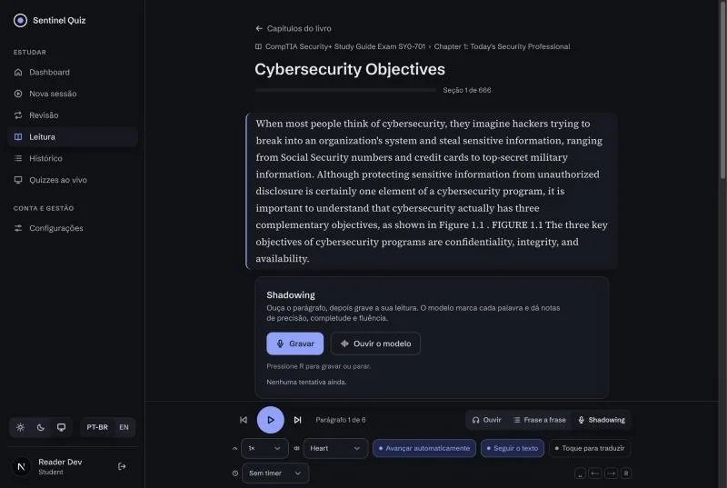
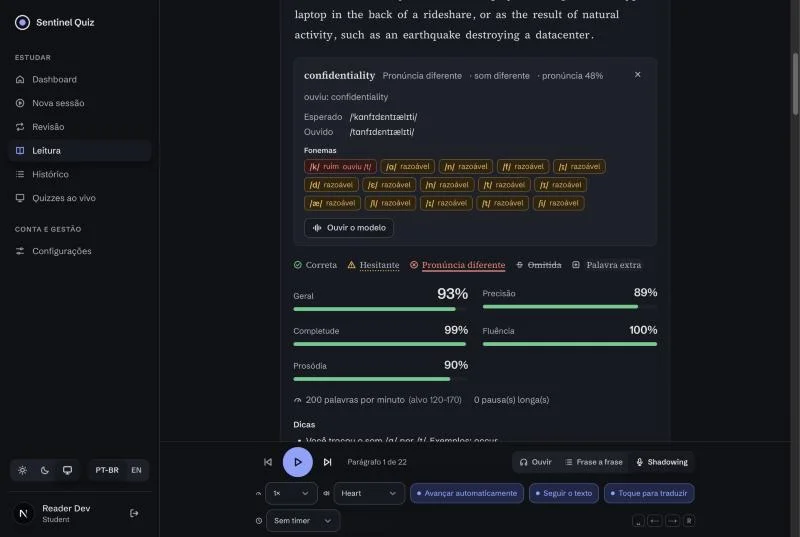
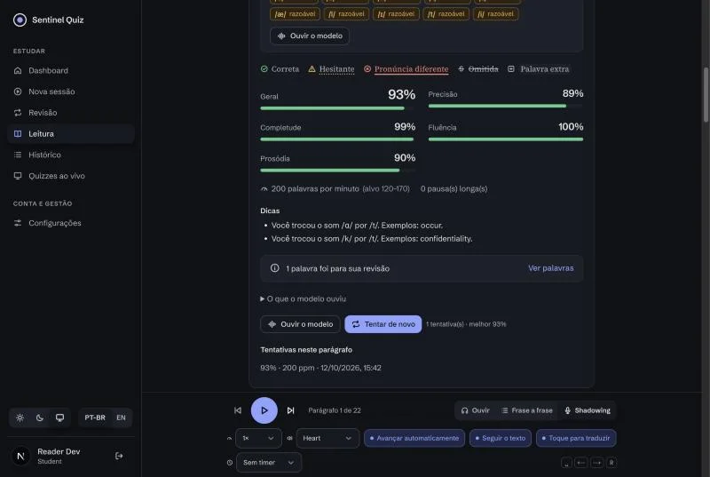
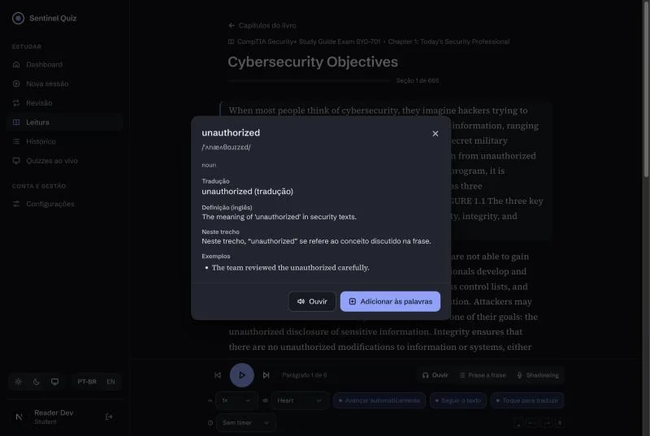
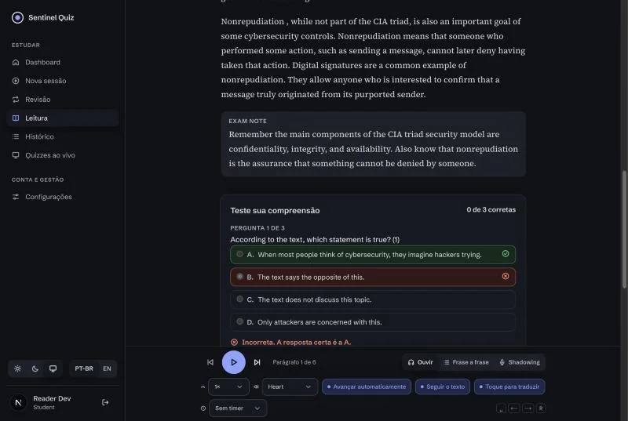
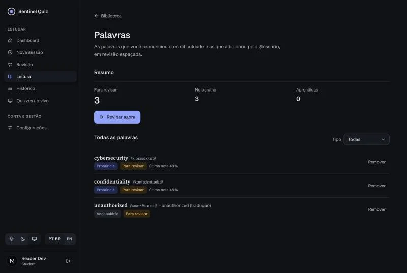
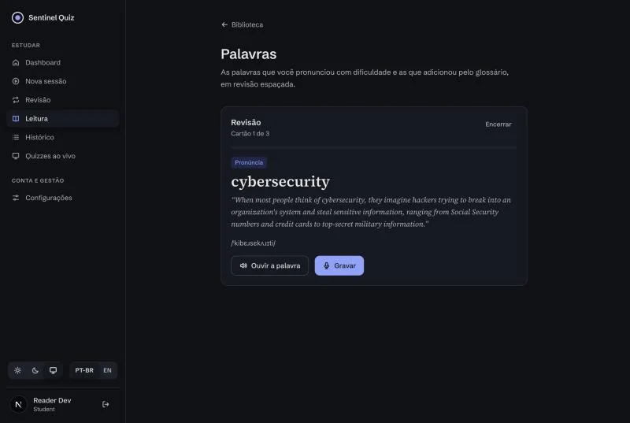
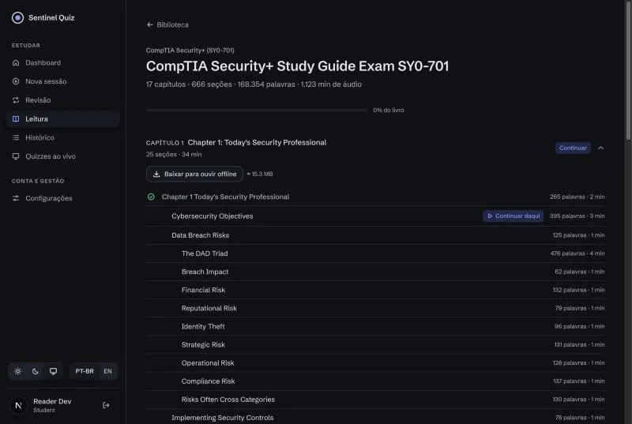
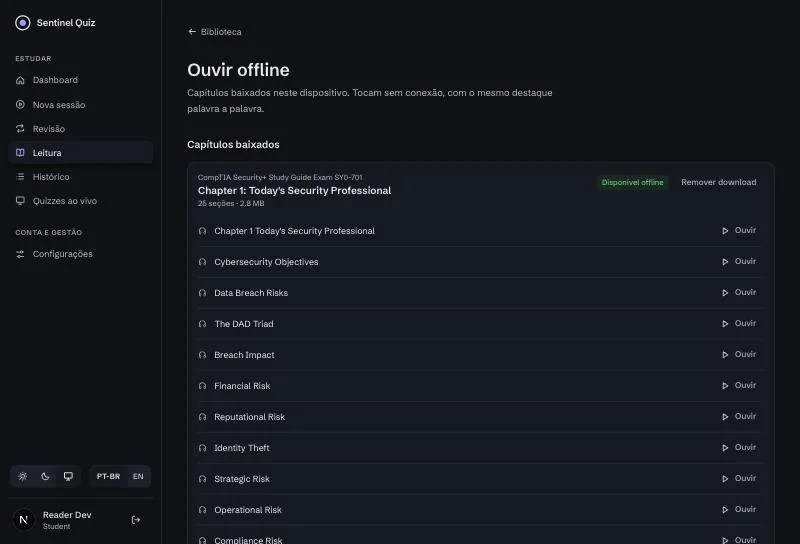

# Sentinel Reader: Incremento 2 (pronúncia por fonema, prática, vocabulário, compreensão e offline)

Segundo incremento do [plano](./PLANO.md), sobre o [contrato](./CONTRATO-INCREMENTO-2.md); junta os itens 2, 3 e 4 do roadmap original.
- **Correção:** a imagem `speech` agora sobe sozinha em Linux/Docker (antes ficava presa em "aquecendo" por causa do modelo do spaCy) e as threads do torch são configuráveis.
- **Pronúncia por fonema:** o som que saiu × o esperado, nota por fonema e por palavra, e prosódia (monotonia e pausas).
- **Prática:** treino frase a frase, baralho de palavras com revisão espaçada (pronúncia gravando, significado por cartão).
- **Entendimento:** glossário com tradução pt-BR no contexto e perguntas de compreensão com evidência do texto.
- **Offline e mobilidade:** capítulos baixados para ouvir sem rede, controles na tela bloqueada e timer de sono.
- **Operação:** métricas Prometheus no `speech`, testes do `speech` no CI, E2E da Leitura, calibração medida e "Seus dados".

## Telas

> Capturas do ambiente local com o livro real, a voz e a IA **de teste** (`SPEECH_PROVIDER=fake`, `AI_PROVIDER=fake`), porque o navegador usado não tem microfone; por isso o IPA e os textos da IA são fictícios. Com o serviço real, a mesma tela mostra o IPA do espeak e o conteúdo do Gemini.

| | |
|---|---|
|  |  |
|  |  |
|  |  |
|  |  |
|  | |

## O que foi entregue

### Serviço de voz (`speech/`)
| Área | Arquivos | Destaques |
|---|---|---|
| Correção | `pyproject.toml`, `Dockerfile`, `engines/kokoro_tts.py`, `config.py` | `en-core-web-sm` 3.8.0 fixo (o build falha se `misaki.en` não importar); `SPEECH_TORCH_THREADS` no lugar do `OMP_NUM_THREADS` fixo |
| Fonemas | `phonemes.py`, `engines/wav2vec2_phoneme.py` | wav2vec2 `facebook/wav2vec2-lv-60-espeak-cv-ft` (**Apache-2.0**, conferido no model card) com um forward por gravação; fonemas esperados do `espeak-ng`; alinhamento CTC (Viterbi em numpy) e GOP por fonema; variantes de sotaque que não são erro aceitas, erros típicos de aprendiz estritos (θ/t, ð/d, v/w, ɪ/iː, æ/ɛ); várias pronúncias esperadas (citação, frase, formas fracas); homófonos não contam como erro |
| Prosódia e notas | `prosody.py`, `scoring.py`, `alignment.py` | F0 por autocorrelação, monotonia, pausas inesperadas e que faltam; `overall = 0,5·accuracy + 0,2·completeness + 0,15·fluency + 0,15·prosody` (`SPEECH_SCORE_WEIGHTS`); pausas depois de pontuação do texto não penalizam; `organization's` × `organization` vira "final da palavra" (`weak`) |
| API | `api.py`, `metrics.py`, `g2p.py` | `POST /v1/g2p`, `GET /metrics` (Prometheus), `/healthz.phoneme`; misaki convertido para IPA padrão |
| Calibração | `scripts/calibrate.py`, [CALIBRACAO.md](./CALIBRACAO.md) | Modo sintético (TTS com palavra omitida, trocada, inserida e "mal pronunciada" por grafia) e modo com gravações humanas rotuladas |
| Testes | `tests/` (68) | alinhamento CTC, GOP, tokenização espeak, IPA, prosódia, notas, API com engines fake, métricas |

**Medições (M1 Pro, CPU):**

| | Sem fonemas | Com wav2vec2 |
|---|---|---|
| RAM em regime / pico | 1,96 GB / 2,4 GB | 3,18 GB / 4,1 GB (limite do container: 6 GB) |
| Avaliar 14,6 s de gravação | 1,50 s | 2,23 s |
| Avaliar 37,5 s de gravação | 3,73 s | 5,84 s |

**Calibração sintética** (450 casos, 3 vozes): `missed` com precisão 1,00 e revocação 0,98; trocas de palavra 86/90 detectadas; palavras lidas certo saem `ok` em 98,5 % e nenhuma é rebaixada pelos fonemas. Nas grafias "mal pronunciadas" que o Whisper aceitou, 34 de 35 mostram o fonema `bad` certo (e viram dica), mas só 1 passa do limiar de palavra de 0,6: subir para 0,7 pegaria mais 5, ao custo de marcar 0,8 % das palavras corretas. O limiar ficou em 0,6 até haver gravações reais de alunos.

**Em `linux/amd64`** (imagem do CI, emulada no Mac): as três engines ficam prontas em ~25 s; "Every *tret* to the network…" contra "threat" devolve a dica θ → t.

### Backend
| Área | Arquivos | Destaques |
|---|---|---|
| Dados | `alembic/versions/0027_reading_practice.py`, `models.py` | `reading_attempt.sentence_index`, `reading_word`, `reading_glossary_entry`, `reading_section_quiz`, `reading_quiz_answer`, `reading_ai_call`; testada também em PostgreSQL |
| Frase a frase | `services/reading.py`, `material_corpus.py` | `sentences` por bloco (mesmo separador do corpus) e `sentence_index` na avaliação |
| Palavras | `services/reading_words.py` | Entrada automática após cada avaliação (até 8), SM-2 simplificado, revisão por gravação ou por nota, TTS da palavra |
| IA | `services/reading_ai.py`, `ai_authoring/provider.py` | Glossário e compreensão pelo provedor existente (Gemini ou fake), JSON validado, evidência literal obrigatória, cache por contexto/seção, quota diária `READING_AI_DAILY_QUOTA` |
| Seus dados e offline | `services/reading_data.py`, `api/reading.py` | Exportar/apagar; manifesto offline por capítulo |
| Operação | `middleware/rate_limit.py`, `api/reading.py` | DELETE no bucket `reading`; logs estruturados `reading_tts`/`reading_assess`/`reading_ai` com duração e código |
| Testes | `tests/test_reading_practice.py` (21) | frase a frase, baralho e SM-2, glossário, compreensão (cache, quota, validação), exportar/apagar, manifesto, capacidades |

### Frontend (`web/`)
| Área | Destaques |
|---|---|
| Resultado | Tocar numa palavra abre os fonemas (bom/razoável/ruim com texto), esperado × ouvido, "ouvir o modelo"; quinto medidor de prosódia; motivo da marcação em texto; aviso de quantas palavras foram para a revisão |
| Modos | Ouvir · Frase a frase · Shadowing; no drill a frase atual fica destacada e avança sozinha com 85 % |
| Glossário | "Toque para traduzir" (ou duplo clique / toque longo), popover acessível com IPA, áudio, tradução, definição, contexto e "Adicionar às palavras" |
| Compreensão | Cartão no fim da seção com 3 perguntas, correção no servidor, explicação e evidência |
| Palavras | `/read/words`: resumo, sessão de revisão (pronúncia e significado) e lista |
| Offline | Baixar capítulo (progresso, cancelar, retomar, remover, até 5), `/read/offline` toca tudo do Cache Storage sem API; service worker guarda só a página offline e os assets estáticos (no máximo 400) |
| Mobilidade | MediaSession (tela bloqueada, ±10 s, próximo/anterior) e timer de sono com fade |
| Outros | "Ouvir esta seção" no "Onde revisar"; "Seus dados" na biblioteca; utilidade `font-ipa` (as fontes do app só têm o subconjunto latino) |
| Testes | 621 unitários; E2E `reading.spec.ts` (7 cenários) com livro sintético próprio, voz/IA fake e `MediaRecorder` falso |

### Infra e CI
- Job **`speech-tests`** no CI (torch CPU, engines fake), pré-requisito da publicação das imagens.
- Compose: `APP_SPEECH_PHONEME_ENGINE`/`_MODEL`/`_THREADS`, `APP_SPEECH_TORCH_THREADS`, `APP_READING_AI_DAILY_QUOTA`, `APP_READING_MAX_OFFLINE_CHAPTERS`; memória do `speech` em 6 GB.

## Problemas encontrados na verificação e corrigidos
| Problema | Correção |
|---|---|
| Imagem `speech` presa em "aquecendo" em Linux (spaCy tentava se instalar em tempo de execução) | Modelo do spaCy como dependência fixa e checagem no build |
| Download offline parava em ~60 parágrafos (limite de 60 POST/min por IP) | Ritmo de ~50 sínteses/min e retomada automática após 429/503 respeitando `Retry-After`, com aviso na tela |
| `/read/offline` dizia "navegador sem suporte" mesmo com suporte (checagem feita na renderização do servidor) | Detecção só no cliente (`useSyncExternalStore`) |
| IPA com glifos errados (fontes só com subconjunto latino) | Utilidade `font-ipa` com fontes de sistema que cobrem IPA |
| Dicas repetidas para o mesmo par de sons (provedor de voz de teste) | Agrupadas por par, como no serviço real |
| Cache de assets do service worker crescia a cada deploy | Limite de 400 entradas, removendo as mais antigas |

## Limites conhecidos
- A calibração é sintética (vozes de TTS não são alunos); a revocação de pronúncia errada aceita pelo Whisper ainda é baixa no nível de palavra (aparece como dica). Próximo passo: `calibrate.py --dataset` com gravações reais.
- Microfone real, iPhone (Safari) e tela bloqueada não foram testados nesta máquina; MediaSession só em teste unitário.
- `/read/offline` sem rede nenhuma (com o service worker) não tem E2E; o E2E cobre a reprodução com a API bloqueada.
