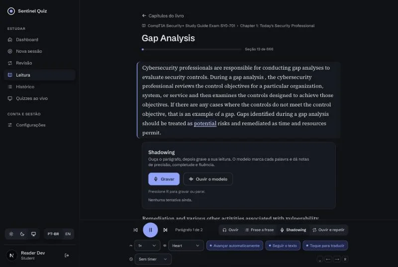
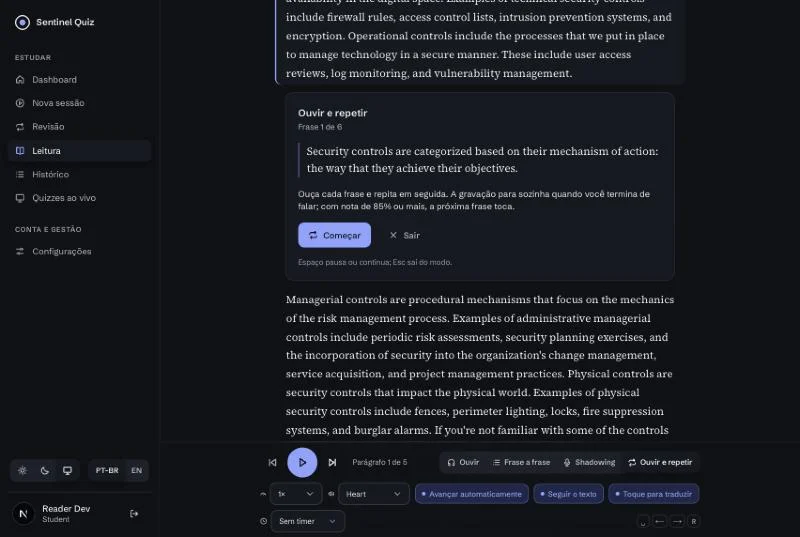
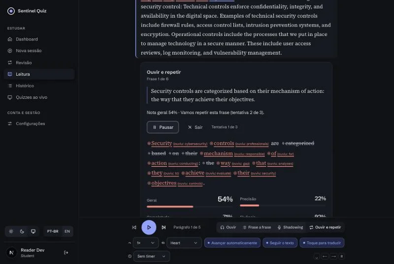

# Sentinel Reader: Incremento 3 (áudio por frase, antecipação, aquecimento e "ouvir e repetir")

Terceiro incremento do [plano](./PLANO.md), sobre o [contrato](./CONTRATO-INCREMENTO-3.md). Motivação: numa VM de 3 a 4 vCPUs o primeiro parágrafo levava 15 a 25 s para começar a tocar.
- **Primeira frase em segundos:** a frase virou a unidade de síntese e de cache; o leitor toca a primeira enquanto as seguintes são geradas.
- **Sem lacunas:** o próximo parágrafo e a próxima seção são antecipados no cliente; o servidor aquece os parágrafos seguintes em segundo plano, com prioridade baixa.
- **Configuração automática:** threads e concorrência a partir dos CPUs que o container realmente tem; fonemas em paralelo com o Whisper quando sobra CPU.
- **Treino contínuo:** modo "ouvir e repetir" mãos livres, com parada por silêncio; velocidades 0,5× e 0,6×; idioma do livro detectado.

## Telas

| | |
|---|---|
|  |  |
|  | |

## O que foi entregue

### Serviço de voz (`speech/`)
| Área | Arquivos | Destaques |
|---|---|---|
| Frases | `textnorm.py` (`split_sentences`), `service.py` | Mesma regra de frases do corpus; fragmentos de menos de 3 palavras juntados; teto de 400 caracteres. Cada frase tem o próprio `audio_id`; o bloco é a concatenação do PCM das frases com um único encode (mesmo `audio_id` de antes, então o download offline não muda). Bloco pedido depois do stream: zero inferência |
| Stream | `api.py` (`POST /v1/tts/stream`) | NDJSON `meta → segment… → done` (ou `error` depois de `meta`); frases em cache saem sem esperar slot; cliente desconectado interrompe a síntese |
| Prioridade | `api.py` (`EngineQueue`), `metrics.py` | `X-Speech-Priority: low|normal`; `low` só pega slot quando nenhum `normal` espera; métricas por prioridade e histograma de espera na fila |
| Runtime | `runtime.py`, `config.py`, `service.py` | `effective_cpus()` pelo cgroup v2/v1, afinidade ou `cpu_count`; threads e concorrência `0` = automático; `SPEECH_PARALLEL_PHONEMES=auto` (paralelo a partir de 6 CPUs); `/healthz.runtime` |
| Testes | `tests/` (100, antes 68) | frases, stream, fila com prioridade, cgroup, defaults automáticos, paralelo = sequencial |

**Medições no MacBook Pro M1 Pro (modelos reais):**

| | Antes | Agora |
|---|---|---|
| Primeira frase de um parágrafo frio (77 a 87 palavras) | 6,2 s (parágrafo inteiro) | **1,0 a 1,5 s** |
| Parágrafo inteiro pronto | 6,2 s | 5,1 a 5,9 s, já tocando desde a primeira frase |
| Parágrafo pedido depois do stream | nova síntese | 0,25 a 0,32 s, 0 inferências |
| Avaliação de 43 s de leitura (4 threads) | 7,1 s | 5,3 s em paralelo; 4,8 s com os defaults automáticos |
| Soma das frases × bloco | — | 35,050 s = 35,050 s; todas as palavras com `text[char_start:char_end] == word` |

### Backend
| Área | Arquivos | Destaques |
|---|---|---|
| Stream | `api/reading.py`, `services/speech_client.py` | `GET /sections/{id}/tts/stream` repassa o NDJSON (`StreamingResponse`), com `text` no `meta` e `audio_url` em cada frase; erros antes do primeiro byte em JSON, depois como linha `error`; `FakeSpeechClient.tts_stream` para testes e E2E |
| Aquecimento | `services/reading_warm.py` | `POST /sections/{id}/warm` → 202; executor de uma thread, fila limitada, deduplicação por posição e janela de 60 s; sintetiza os próximos 6 blocos e o primeiro da próxima seção com `X-Speech-Priority: low`; nunca propaga erro; log `reading_warm` |
| Idioma | `services/material_corpus.py`, `services/reading.py` | `detect_language` por razão de stopwords (en/pt/es/unknown) nas primeiras 20.000 palavras; `language` na biblioteca, na seção e no manifesto offline; 409 `language_unsupported` em TTS, stream, aquecimento e avaliação |
| Capacidades | `schemas_reading.py`, `api/reading.py` | velocidades 0,5× e 0,6×; `tts.streaming`; `warm` |
| Testes | `tests/test_reading_stream.py` (19) | stream, erros, bucket de rate limit, aquecimento (fila, dedupe, prioridade, desligado), idioma, capacidades. Suíte: 550 |

### Frontend (`web/`)
| Área | Destaques |
|---|---|
| Player por frases | `segment-player.ts`: dois elementos de áudio alternados (a próxima frase já carregada), linha do tempo única para destaque, barra, `seek` e MediaSession; estado `buffering` quando a próxima frase ainda não chegou; lacuna medida ≤ 60 ms no teste |
| Stream | `ndjson.ts` + `tts-stream.ts`: leitura linha a linha, download do áudio de cada frase (2 em paralelo), cache no react-query (sobrevive à navegação para a próxima seção), fallback para o modo bloco em 404/405 |
| Antecipação | `prefetch-policy.ts`: um parágrafo à frente; no último, a próxima seção e o primeiro parágrafo dela; aquecimento ao abrir e ao trocar voz/velocidade (debounce 2 s, máximo 1 a cada 60 s) |
| Ouvir e repetir | `listen-repeat.ts` + `listen-repeat-panel.tsx`: modelo → sinal → gravação → avaliação → resultado; avança com 85 %, repete até 3 vezes; pausa/retoma, Esc sai; `silence-detector.ts` (RMS por 100 ms, para 1,2 s depois de ouvir voz, teto por frase) |
| Idioma e velocidades | aviso e selo de idioma; voz do navegador no idioma do livro; Shadowing/Frase a frase/Repetir desativados fora do inglês; 0,5× e 0,6× |
| Testes | 663 unitários (antes 621); E2E `reading.spec.ts` com 10 cenários (streaming, ouvir e repetir, livro em português) |

### Infra
- Compose: threads e concorrência automáticas (`0`), `APP_SPEECH_PARALLEL_PHONEMES=auto`, cache de 8 GB, `APP_SPEECH_CPUS` padrão 2.0, variáveis de aquecimento.
- README: tabela de dimensionamento por máquina (4 vCPU, 8 e 16 núcleos).

## Verificação ponta a ponta (Mac, modelos reais, navegador)
- `GET …/tts/stream` de um parágrafo frio de 78 palavras: `meta` em 0,03 s, primeira frase em **1,46 s**, cinco frases até 5,08 s; o parágrafo pedido logo depois volta em 0,25 s.
- No leitor: o áudio começa pela primeira frase, o destaque de palavra atravessa as frases, o próximo parágrafo é antecipado durante a reprodução e a próxima seção abre sem espera no fim.
- Aquecimento: `POST …/warm` enfileirou 7 parágrafos e o serviço os sintetizou em prioridade baixa.
- "Ouvir e repetir" com microfone simulado: tocou a frase, gravou, parou por silêncio, avaliou com os modelos reais, mostrou a nota e repetiu a frase.

## Limites conhecidos
- Feedback em tempo real durante a leitura (ASR em streaming) fica para quando houver CPU sobrando; hoje cada frase é avaliada ao terminar.
- A calibração continua sintética; a ferramenta `calibrate.py --dataset` aceita gravações reais rotuladas.
- As estimativas de latência para a VM de 4 vCPUs são projeção (primeira frase em 2 a 4 s); medir no servidor com `/metrics`.
